# diffusion-from-scratch


Score-based generative modeling built from the score outward, in PyTorch, on
2D targets whose scores are known in **closed form**.

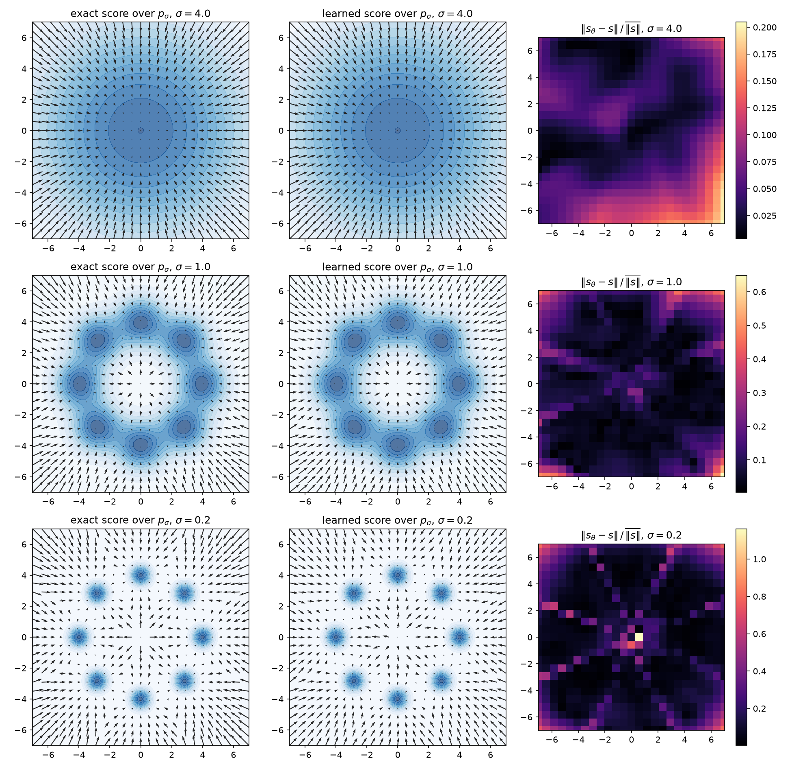

*The object a diffusion model estimates, and the estimate, side by side. Rows
are noise levels — $\sigma = 4$, $1$, $0.2$ — of an 8-mode ring mixture. Left
is the **exact** score of the noised density $p_\sigma$, which is available
here because a Gaussian mixture stays a Gaussian mixture when noised; middle
is what an 87k-parameter network learned by denoising score matching; right is
the error, normalized by that level's mean $\\|s\\|$. The learned field is not
a picture that looks about right — it is wrong by a measurable amount, and the
amount is worst at the **fine** level, exactly where the training loss looks
best. Everything below is that observation, taken seriously.*

A diffusion model is an estimate of one object:

$$s(x) = \nabla_x \log p(x).$$

Everything else — Langevin sampling, denoising score matching, the reverse-time
SDE, the probability-flow ODE — is written in terms of it. So the design
decision this repo makes first is: *use targets where the truth is available*.
A 2D Gaussian mixture has an analytic score, exact moments, and an exact
sampler, and — the property everything here rests on — it **stays a Gaussian
mixture when noised**, so the score of the noised marginal is closed-form at
every noise level. A learned score can therefore be reported as an *error
against truth* rather than as a picture that looks about right, and a sampler
can be run with the exact score as a control, which separates score-estimation
error from discretization error. Neither check exists on an image dataset.
That is why the toys are the point and not a shortcut.

## Core modules

| Module | Contents |
| --- | --- |
| [`diffusion/targets.py`](diffusion/targets.py) | `GaussianMixture` (responsibility-weighted analytic score, exact moments and sampler, closed under noising), `TwoMoons` built as an actual normalized density in polar coordinates rather than a sampling recipe, and the finite-difference oracle every score is checked against |
| [`diffusion/langevin.py`](diffusion/langevin.py) | Unadjusted Langevin, and Song & Ermon's annealed Langevin with the $\tau_i \propto \sigma_i^2$ step-size schedule and the stability bound that schedule implies; plus the three noise ladders (geometric, linear, and the cosine schedule rederived for a variance-exploding process) |
| [`diffusion/model.py`](diffusion/model.py) | The score network: an MLP conditioned on $\log\sigma$ through a written-out sinusoidal embedding, with the score formed as $-\epsilon_\theta/\sigma$ so the learned object is unit-scale at every noise level |
| [`diffusion/dsm.py`](diffusion/dsm.py) | Denoising score matching (Vincent 2011) with its equivalence proof, the $\sigma^2$ weighting that collapses it to $\\|\epsilon_\theta - \epsilon\\|^2$, per-level diagnostics against the exact score, and the loss's irreducible floor |
| [`diffusion/vp.py`](diffusion/vp.py) | The variance-preserving process as the SNR-matched rescaling of this repo's variance-exploding one, its score and Tweedie by the Jacobian, DDPM's ancestral update derived in $\bar\alpha$ and $\beta$ (which collapses onto the VE sampler exactly), the prior-variance accounting that is the only place the two conventions differ, and the input-scale closed form plus the one-multiplication network that put the O(1)-input argument under measurement |
| [`diffusion/samplers.py`](diffusion/samplers.py) | Ancestral (DDPM) sampling down the ladder, derived for this repo's variance-exploding chain, with the closed-form variance it returns on a Gaussian target — including the deficit a coarse ladder is *supposed* to have |
| [`diffusion/metrics.py`](diffusion/metrics.py) | Two-sample metrics written out: RBF-kernel MMD with a permutation test, sliced Wasserstein, and the exact value each takes on Gaussians |
| [`diffusion/ode.py`](diffusion/ode.py) | The probability-flow ODE with $\sigma$ as the clock, a written-out RK4 (measured fourth-order), and likelihoods by instantaneous change of variables with a Hutchinson trace estimator — plus the exact flow on a Gaussian, which is what the solver is tested against |

[`theory/derivations.md`](theory/derivations.md) carries the maths behind all
of it, section-numbered to match the modules: the mixture's score and its
closure under noising, Tweedie's formula, Hyvärinen's identity and Vincent's
denoising form of it, Anderson's reverse-time SDE and the ancestral sampler as
its discretization, the probability-flow ODE and its likelihoods, and the
Langevin bridge back to
[mcmc-from-scratch](https://github.com/porth-bot/mcmc-from-scratch).

Every sampler takes the score as a callable, so the same code runs on the
*exact* score and on the network. That is what makes the sampler claims
testable at all: run both and the difference is estimation error, full stop.

### What a learned score is actually worth, measured

Because the mixture is closed under noising, a trained network can be scored
against the truth at every level rather than eyeballed
([`experiments/score_matching.py`](experiments/score_matching.py), 8-mode
ring, 87k parameters, 60k steps, ~2 min on CPU):

| $\sigma$ | 0.05 | 0.18 | 0.63 | 2.25 | 8.0 |
| --- | --- | --- | --- | --- | --- |
| relative MSE | 1.1e-1 | 2.8e-2 | 2.1e-2 | 4.2e-3 | 4.6e-3 |
| cosine | 0.896 | 0.970 | 0.976 | 0.955 | 0.996 |
| cosine, weighted by $\\|s\\|$ | 0.946 | 0.989 | 0.990 | 0.997 | 0.999 |

The fine end is the worst, which the $-\epsilon_\theta/\sigma$
parameterization predicts: any error in $\epsilon_\theta$ is amplified by
$1/\sigma$ precisely where the loss looks best.

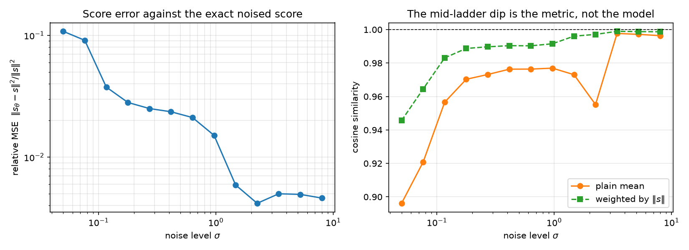

*The table above, at every level of the ladder rather than five of them. Left:
relative MSE against the exact noised score, climbing an order of magnitude as
$\sigma$ falls — the error is a property of where on the ladder you look, not a
single number. Right: the two cosines. They agree at the coarse end and split
below $\sigma \approx 1$, and the plain mean's dip near $\sigma = 2$ is the
measurement trap two sections down, not a defect of the model.*

### The training loss cannot tell you when to stop

The DSM loss does not go to zero. Its floor is
$\mathbb{E}\\|\epsilon - \mathbb{E}[\epsilon \mid x]\\|^2$, which runs from
$d = 2$ as $\sigma \to 0$ (the noisy point reveals $x_0$ and says nothing
about the noise) to $0$ at large $\sigma$ (the point is almost pure noise, so
the noise is nearly determined) — the opposite of the intuition that fine
levels are the easy ones. Averaged over the training measure it is
$1.203$ here, computed exactly.

So a well-trained network reports $1.212$ and a barely-trained one $1.228$,
and one minibatch's loss has a standard deviation of $0.073$ — eight times
the entire remaining excess. Subtract the floor and the same curve is
informative: excess risk falls from $0.025$ at step 2k to $0.0093$ at 60k
while the true relative score error falls 4.5×. This is the concrete payoff
of a target with a known score, and it is why the repo reports error against
truth rather than a loss curve.

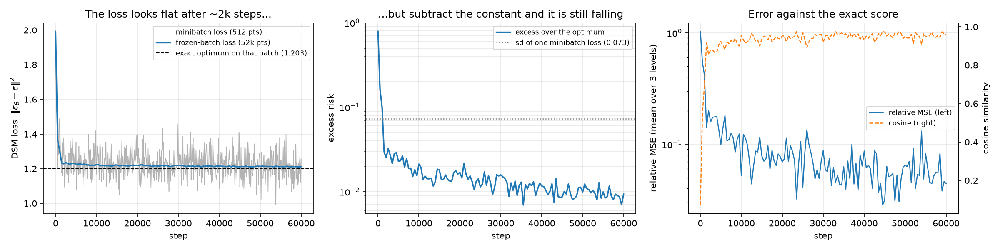

*The same run, read three ways. Left: the DSM loss, flat against its exact
optimum (dashed) from ~2k steps on, with one minibatch's noise swamping the
remaining excess. Middle: subtract the optimum and the excess risk is still
falling at 60k steps — under the dotted line marking the sd of a single
minibatch loss, i.e. entirely inside what the left panel could never have
resolved. Right: the quantity that actually matters, error against the exact
score, falling over the same stretch the loss called finished.*

### Averaging the weights is worth more than the last 15k steps of training

Every diffusion codebase keeps an EMA of its weights and none of them shows
the number, so here it is. The comparison is *paired*: the shadow never feeds
back into the gradient, so the raw arm of an EMA run is bit-for-bit the run
you would have got with the average off (asserted in
[`tests/test_ema.py`](tests/test_ema.py)), and the two arms are the same run
evaluated twice. 20k steps, five seeds, relative MSE against the exact noised
score.

| EMA decay $d$ | raw | EMA | ratio | seeds EMA wins |
|---|---|---|---|---|
| 0.99   | $0.0906 \pm 0.0387$ | $0.0230 \pm 0.0045$ | 0.25 | 5/5 |
| 0.999  | $0.0906 \pm 0.0387$ | $0.0143 \pm 0.0022$ | 0.16 | 5/5 |
| 0.9995 | $0.0906 \pm 0.0387$ | $0.0155 \pm 0.0019$ | 0.17 | 5/5 |
| 0.9999 | $0.0906 \pm 0.0387$ | $0.0156 \pm 0.0020$ | 0.17 | 5/5 |

A 6.3× lower score error at $d = 0.999$, and — the part a single-seed
comparison cannot see — a **17× smaller seed-to-seed spread**. The raw arm's
sd is 43% of its own mean; the EMA arm's is 16% of a mean six times smaller.
The worst raw seed (0.150) is worse than the best (0.061) by more than the
entire raw-to-EMA gap, so on this problem *which seed you drew* matters more
than 15k of the 20k training steps, and averaging removes both.

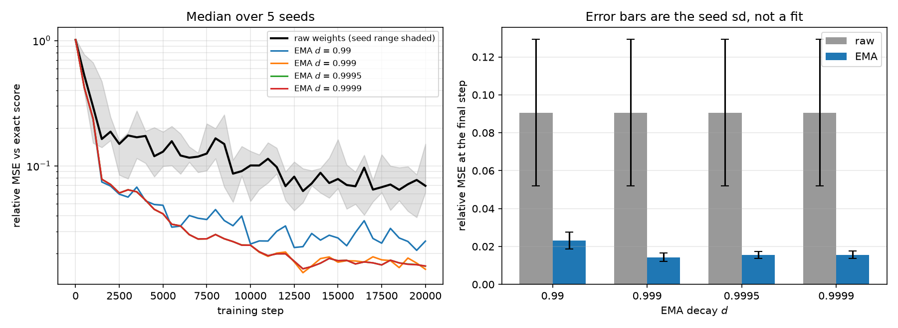

*Left: median over five seeds, raw weights in black with the seed range
shaded. The raw curve stops improving around step 5k and then wanders inside
a band it never leaves — the jitter EMA is there to remove. Right: final
error, error bars the seed sd.*

**What did not happen, and it is the thing this was written to find.** The
standard caution is that an EMA lags: while the weights are still travelling,
averaging them averages worse parameters, so a decay long relative to the run
should lose. The crossover is at the second evaluation (step 500 of 20,000)
for *every* decay tried, including $d = 0.9999$, whose nominal averaging
window is half the run. Only the step-1 checkpoint, where the shadow is still
mostly initialization, is genuinely worse.

**The caveat that limits how far the top of that table generalizes.** The
warmup correction $d_t = \min(d,\ (1+t)/(10+t))$ reaches $d$ only at
$t = (10d-1)/(1-d)$: step 8,990 for $0.999$, step 17,990 for $0.9995$, and
*never* inside 20k steps for $0.9999$ — which at step 20,000 is still being
run at $0.99955$. So the three largest arms were executing nearly the same
schedule, and their agreement is a fact about the warmup ramp, not evidence
that the decay stops mattering above $0.999$. Separating them needs a longer
run than this one.

The variance argument in [`diffusion/ema.py`](diffusion/ema.py) predicts a
variance reduction of $(1-d)/(1+d) = 5\times10^{-4}$ at $d=0.999$ under
i.i.d. jitter. The measured reduction is $3.4\times10^{-3}$ — seven times
short of the bound, which is what positively-correlated Adam iterates should
do to it. The bound is a bound.

### One measurement trap, recorded

The plain mean cosine dips to 0.955 mid-ladder. That is not the model: at
that level the ring has collapsed into a blob and 9% of the draws land in the
field's near-zero interior, where direction is undefined and a cosine
measures noise. Weighted by $\\|s\\|$ the same level reads 0.997. Both
statistics are reported, with the near-zero fraction beside them, so the dip
can be attributed rather than guessed at.

### The step size is bounded, and the bound is enforced

Noising bounds curvature, so it bounds the step size. The score of a
$\sigma$-noised density is a posterior mean, $s_\sigma(x) = (\mathbb{E}[x_0
\mid x] - x)/\sigma^2$, whose Jacobian is $(\mathrm{Cov}[x_0 \mid x]/\sigma^2 -
I)/\sigma^2 \succeq -I/\sigma^2$ for **any** base density. Linearizing the ULA
update, contraction needs $\tau|\lambda| < 4$, so $\tau_i < 4\sigma_i^2$ — one
condition, $\tau < 4\sigma_L^2$, covering every level of the ladder.

`annealed_langevin` refuses a $\tau$ above it, because this repo's own first
draft was above it and nearly got away with it. An unstable ladder does not
blow up visibly: the coarse levels drive the state to $10^{80}$ and the
strongly contractive fine levels squash it back, returning samples with the
right support and the *wrong mode weights* — invisible on a symmetric target.
A 25/75 mixture read 0.53 instead of 0.75, which is why an asymmetric mixture
is now a permanent test. The bound is necessary, not sufficient: at half the
bound the same test still reads 0.70.

## Sampling: three errors, taken apart

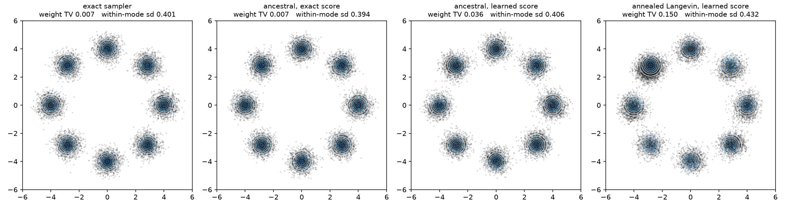

A sample can be wrong for three reasons, and on a target with a known score
each one has an off switch: **prior mismatch** (start from an exact draw from
$p_{\sigma_{\max}}$ instead of from $N(0,\sigma_{\max}^2 I)$), **discretization**
(refine the ladder), and **score estimation** (pass the analytic noised score
through the identical sampler). [`experiments/sampling.py`](experiments/sampling.py)
runs all three, 16,000 samples per arm, measured against an independent exact
draw — which is itself a row, because neither metric reads zero at finite
sample size:

| sampler | score | init | NFE | weight TV | mode sd | sliced $W_2$ | MMD $p$, $h=5.71$ | MMD $p$, $h=0.4$ |
| --- | --- | --- | ---: | ---: | ---: | ---: | ---: | ---: |
| exact sampler | — | — | 0 | 0.005 | 0.401 | 0.043 | 0.26 | 0.48 |
| ancestral | exact | $p_{\sigma_{\max}}$ | 200 | 0.005 | 0.394 | 0.076 | 0.81 | 0.99 |
| ancestral | exact | $N(0,\sigma_{\max}^2)$ | 200 | 0.007 | 0.394 | 0.050 | 0.73 | 0.24 |
| ancestral | **learned** | $N(0,\sigma_{\max}^2)$ | 200 | 0.036 | 0.406 | 0.150 | 0.37 | **0.010** |
| annealed Langevin | exact | $N(0,\sigma_{\max}^2)$ | 200 | 0.012 | 0.419 | 0.047 | 0.72 | 0.46 |
| annealed Langevin | **learned** | $N(0,\sigma_{\max}^2)$ | 200 | 0.066 | 0.428 | 0.274 | 0.015 | **0.005** |
| annealed Langevin | exact | $N(0,\sigma_{\max}^2)$ | 2000 | 0.008 | 0.405 | 0.064 | 0.24 | 0.25 |
| annealed Langevin | **learned** | $N(0,\sigma_{\max}^2)$ | 2000 | 0.150 | 0.432 | **0.807** | 0.005 | 0.005 |

Sliced $W_2$ between two independent exact draws is $0.066 \pm 0.020$ (eight
pairs, range 0.036–0.092), so that band is the floor, not zero; $p = 0.005$ is
the resolution floor of a 199-permutation test, not a measured 0.005. Target
mode width is 0.4 and an exact draw reads 0.401.

With the exact score, ancestral sampling at 200 levels is indistinguishable
from an exact draw on every statistic here, and the prior mismatch at
$\sigma_{\max} = 8$ costs nothing measurable. Swapping in the learned score is
what moves the numbers.

The two samplers are wrong in opposite directions, which is worth noticing:
ancestral comes back a little *narrow* (0.394 against 0.401) because it
discards the posterior spread over $x_0$ at every level, while annealed
Langevin at 200 evaluations comes back *wide* (0.419) because ten steps per
level is not enough to contract the state down from the previous, broader
level. Giving it ten times the budget fixes that particular defect — 0.405 —
and, with the learned score, breaks something larger.

### More compute makes the Langevin sampler *worse*

The last three rows are the day's real finding, and it took the exact-score
control to make it a finding rather than a guess. Annealed Langevin with the
learned score goes from sliced $W_2$ 0.274 at 200 evaluations to **0.807 at
2000** — ten times the budget, three times the error, mode weights off by
0.150 in TV. The same sampler with the *exact* score does not degrade
(0.047 → 0.064, both at the floor), so this is not the ladder, the step size,
or the stability bound. It is the score.

The reason is what an equilibrium sampler is for. Langevin converges to the
stationary distribution of the score it is handed, so a biased score has a
biased stationary law and more steps converge to it *harder*. Ancestral
sampling never equilibrates — it visits each level exactly once — so the same
score error stays a perturbation instead of becoming a limit. That inverts the
usual reading of a compute knob: here the sampler that cannot be run longer is
the one protected from being run longer.

### Discretization error closes; estimation error does not

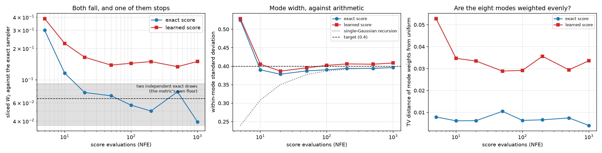

Refining the ancestral ladder drives the exact-score arm into the reference
floor by about 20 evaluations and it stays there. The learned-score arm falls
alongside it and then stops, at sliced $W_2 \approx 0.14$ and mode-weight TV
$\approx 0.03$, a plateau no amount of further refinement touches — because
what remains is not a step-size error.

The middle panel is a check nobody ordered. `ddpm_gaussian_variance` predicts
the variance the sampler returns on a *single* Gaussian; applied to one
component of the mixture it predicts the *within-mode* width, and once the
ladder is fine enough to resolve a mode it is right to under 1%:

| NFE | 20 | 50 | 100 | 200 | 1000 |
| --- | --- | --- | --- | --- | --- |
| predicted mode sd | 0.350 | 0.378 | 0.387 | 0.392 | 0.396 |
| measured (exact score) | 0.378 | 0.387 | 0.390 | 0.394 | 0.396 |

The gap at NFE 20 is real and expected: the coarse levels of that ladder do
not see one mode at a time, so a single-Gaussian recursion has no reason to
apply there, and it does not.

### The median heuristic picks the wrong scale

Look along the learned-ancestral row: MMD reports $p = 0.37$ at the
median-heuristic bandwidth and $p = 0.010$ at $h = 0.4$. Both are the same
test on the same samples.

The median pairwise distance on this target is 5.71, which is the *diameter of
the ring* — a kernel that wide compares gross shape and steps straight over
whether the individual modes have the right width. Set $h$ to the component
standard deviation, 0.4, and the test resolves the structure that actually
differs. The median heuristic is a sensible default and it is not an oracle;
on a target with structure at two scales an order of magnitude apart, it finds
the one you were not asking about. Sliced Wasserstein, which has no bandwidth,
flags the same row without being told where to look.

## Take the noise out: the probability-flow ODE

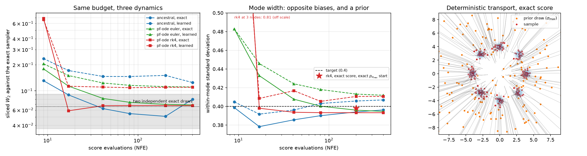

The forward process has no drift, so its density obeys the heat equation
$\partial_t p = \tfrac12 g^2 \Delta p$. Write $\Delta p = \nabla\cdot(p \nabla \log p)$
and that *is* a continuity equation — which says $p$ is transported by a
velocity field. Taking $\sigma$ as the clock instead of $t$, the schedule
cancels out of it entirely:

$$\frac{dx}{d\sigma} = -\sigma\, s(x, \sigma).$$

So sampling becomes an initial value problem, and two things fall out of the
same equation. One Euler step of it is **half** the ancestral sampler's mean
update — the missing half plus the injected noise are a Langevin step, which
leaves $p_\sigma$ invariant, so the stochastic sampler is this ODE plus a term
that does nothing in exact arithmetic. And on a Gaussian target the ODE
separates: every point moves along its own ray by
$\sqrt{(v+\sigma_1^2)/(v+\sigma_0^2)}$, an exact solution the solver is tested
against *pointwise*, which is how `tests/test_ode.py` measures RK4's order as
4.0 and Euler's as 1.0 rather than trusting the label.

### Same budget, three dynamics

[`experiments/ode.py`](experiments/ode.py) puts the ancestral sampler and the
PF-ODE (Euler and RK4) on one axis: score evaluations. RK4 spends four per
step, so at a budget of 41 it gets 11 nodes against the ancestral sampler's 41
levels. Sliced $W_2$ against an exact draw, 16,000 samples per cell:

| sliced $W_2$ | NFE 9 | 17 | 41 | 81 | 201 | 401 |
| --- | ---: | ---: | ---: | ---: | ---: | ---: |
| ancestral, exact | 0.131 | 0.090 | 0.062 | 0.055 | 0.051 | 0.080 |
| PF-ODE Euler, exact | 0.180 | 0.113 | 0.082 | 0.074 | 0.070 | 0.069 |
| PF-ODE RK4, exact | 0.687 | **0.059** | 0.067 | 0.068 | 0.068 | 0.068 |
| ancestral, **learned** | 0.236 | 0.172 | 0.147 | 0.146 | 0.151 | 0.125 |
| PF-ODE Euler, **learned** | 0.205 | 0.150 | 0.123 | 0.116 | 0.112 | 0.111 |
| PF-ODE RK4, **learned** | 0.666 | 0.113 | 0.111 | 0.109 | 0.110 | 0.110 |

Read the exact-score rows against the floor, not against zero: two independent
exact draws differ by $0.066 \pm 0.020$ (range 0.036–0.092 over eight pairs), so
from 41 evaluations on **all three are inside that band and none of them is
distinguishable from an exact draw, or from each other**. What can still be said
is who gets there first: at 17 evaluations RK4 reads 0.059, at the floor's
centre, while the ancestral sampler is at its top edge (0.090) and Euler is
outside it (0.113). And at 9 evaluations, where RK4 has 2 steps to work with, it
is by far the worst of the three (0.687) — fourth-order accuracy buys nothing
until there are steps to be accurate over.

The learned-score rows are outside the band, and they separate: the ODE sits
below the ancestral sampler at every matched budget from 17 up, with steadier
mode weights (TV 0.019 against 0.031). Each individual gap is about twice the
floor's own spread; what makes the ordering credible is that five budgets and
two statistics all point the same way. The honest summary is that *which
dynamics is better here is a property of the score, not of the samplers* — with
the truth in hand the noise costs nothing, and with a biased score the extra
randomness does not help.

Middle panel, the coarse-ladder biases, which point in opposite directions:
ancestral approaches the target mode width **from below** (0.378 at 17
evaluations, 0.396 at 401) because it replaces the posterior over $x_0$ by its
mean and loses spread; Euler approaches it **from above** (0.433 → 0.395)
because an under-resolved flow has not finished contracting.

### A deterministic sampler inherits its prior, permanently

One number in that sweep does not move at all: the ODE's mode-weight TV with
the exact score is **0.0121 at every budget from 9 to 401**, to four decimals.
That is not a coincidence, it is what determinism means — the map from prior
draw to sample is a fixed diffeomorphism, so which mode each prior point lands
in is decided by the prior sample, and refining the solver cannot re-roll it.
The stochastic sampler's TV wanders between 0.004 and 0.012 across the same
budgets because it re-randomizes at every level.

That also explains the floor under the ODE's mode width (0.3932 against a
target of 0.4, flat from 81 evaluations on). Feed the identical run an exact
draw from $p_{\sigma_{\max}}$ instead of $N(0, \sigma_{\max}^2 I)$:

| PF-ODE RK4, 201 NFE | weight TV | mode sd | sliced $W_2$ |
| --- | ---: | ---: | ---: |
| exact score, $N(0,\sigma_{\max}^2)$ start | 0.0121 | 0.3932 | 0.068 |
| exact score, exact $p_{\sigma_{\max}}$ start | 0.0055 | 0.3980 | 0.065 |

Prior mismatch, and nothing else, was most of what remained.

### The noise schedule cancels — for one of the two samplers

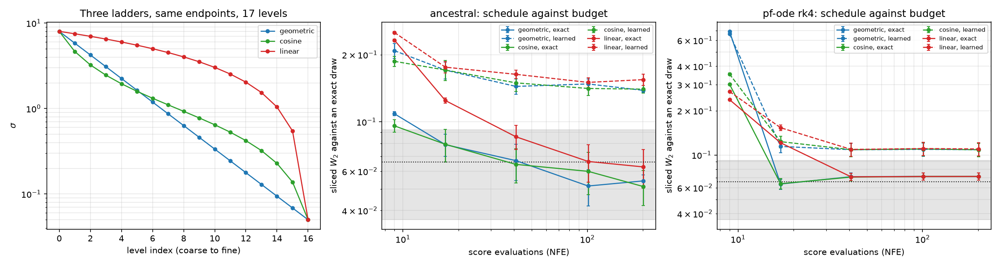

If the schedule really does drop out of $dx/d\sigma = -\sigma s$, then two
ladders with the same endpoints describe the same trajectory and differ only in
where they put nodes. That is a statement about the continuous limit, so
[`experiments/schedules.py`](experiments/schedules.py) asks what it is worth at
a finite budget. Three ladders, each uniform spacing in a different warp of
$\sigma$:

- **geometric** — uniform in $\log\sigma$, the repo's default.
- **linear** — uniform in $\sigma$, the naive choice.
- **cosine** — uniform in $\arctan\sigma$. That *is* Nichol & Dhariwal's
  schedule: their $\bar\alpha = \cos^2(\pi u/2)$ is variance-preserving, and a
  VP state is $\sqrt{\bar\alpha}\,(x_0 + \sigma\varepsilon)$ with
  $\sigma^2 = (1-\bar\alpha)/\bar\alpha$, so $\sigma(u) = \tan(\pi u / 2)$.

Sliced $W_2$ against an exact draw, exact score, 16,000 samples per cell,
averaged over three prior draws (seed-to-seed sd averages 0.008):

| exact score | NFE 9 | 17 | 41 | 101 | 201 |
| --- | ---: | ---: | ---: | ---: | ---: |
| ancestral, geometric | 0.109 | 0.079 | 0.067 | 0.052 | 0.054 |
| ancestral, cosine | 0.096 | 0.079 | 0.064 | 0.060 | 0.051 |
| ancestral, linear | **0.233** | 0.125 | 0.086 | 0.066 | 0.063 |
| PF-ODE RK4, geometric | **0.689** | 0.064 | 0.0713 | 0.0715 | 0.0715 |
| PF-ODE RK4, cosine | 0.302 | 0.064 | 0.0708 | 0.0715 | 0.0715 |
| PF-ODE RK4, linear | 0.237 | 0.121 | 0.0711 | 0.0715 | 0.0715 |

**The ODE forgets the schedule, on schedule.** Its three arms disagree by 0.451
at 9 evaluations — 57× the seed-to-seed spread — then by 0.058 at 17, 0.0005 at
41, and 0.0001 from 101 on, which is below what the statistic can resolve. Three
different ladders, the same answer to four decimals: the cancellation is not a
rewriting trick, it is something the sampler actually does.

**The ancestral sampler does not.** Its spread never closes: 0.021 at 41, 0.015
at 101, 0.016 at 201, always with the linear ladder worst. That is the right
outcome rather than a discrepancy — the derivation covers the flow, not the
chain, and the chain's per-level plug-in error (§ ancestral, above) depends on
the *gap* between adjacent levels. At 201 levels the linear ladder's finest
ratio is still 1.79 where the geometric one is 1.03.

**And at 9 evaluations the two samplers rank the schedules in opposite orders.**
Linear is the worst ancestral ladder (0.233) and the best ODE one (0.237 against
geometric's 0.689), because RK4 at that budget has 3 nodes and the geometric
ladder spends them at the fine end where this target's flow has already stopped
moving, while the ancestral sampler has 9 levels and is hurt by linear's final
ratio of 21. A study that ran one sampler would have come away with a
schedule recommendation that is wrong for the other one.

The practical conclusion is the least dramatic reading. At any budget past 41,
swapping the schedule moves the learned-score ODE by less than 0.0015 while the
score being learned rather than exact costs 0.037 — more than twenty-five
times as much.
On this target the schedule is a knob worth setting sensibly once and then
leaving alone.

### VP and VE are one chain in two coordinate systems

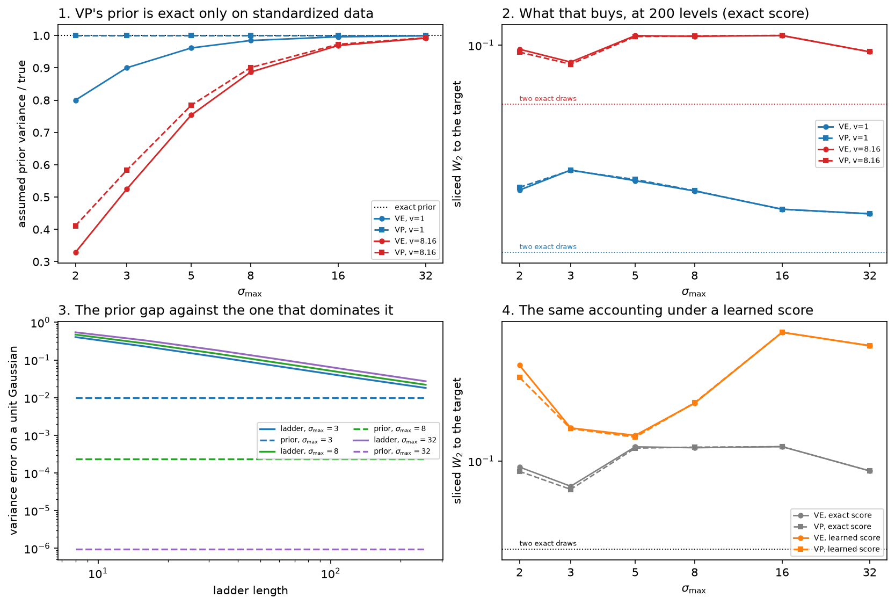

The cosine schedule above arrives through a rescaling
$\sqrt{\bar\alpha}(x_0 + \sigma\varepsilon)$, and it is worth asking how far
that rescaling goes. All the way, it turns out.
[`diffusion/vp.py`](diffusion/vp.py) matches the two processes at the
signal-to-noise ratio, $\sigma^2 = (1-\bar\alpha)/\bar\alpha$, and then for the
*same* $x_0$ and the *same* $\varepsilon$ the VP state is exactly
$\sqrt{\bar\alpha}$ times the VE state — pathwise, not in distribution.
Deriving DDPM's ancestral update in $\bar\alpha$ and $\beta$ and substituting,
$\beta_i/\bar\alpha_i = \sigma_i^2 - \sigma_{i-1}^2$ and
$\tilde\beta_i = \bar\alpha_{i-1}\,\sigma_{i-1}^2(\sigma_i^2 -
\sigma_{i-1}^2)/\sigma_i^2$, so mean *and* noise pick up the same factor and
the two samplers are the same chain.

`ddpm_ancestral_vp` shares no code with `ddpm_ancestral` on purpose, so this is
a claim about the algebra and not about an implementation. Driven with
identical noise draws the two trajectories agree to $10^{-11}$ in float64
(`tests/test_vp.py`) and to $2\times10^{-4}$ on states of size 5.2 in the
experiment's float32 — rounding, not a difference. **So the choice of process
is not a modelling choice**, and everything this repo measured under VE
transfers.

**One thing does not transfer: the prior.** Push VE's
$N(0,\sigma_{\max}^2 I)$ through the rescaling and it becomes
$N(0,(1-\bar\alpha_{\max})I)$, not the $N(0,I)$ that VP conventionally starts
from. For data of per-coordinate variance $v$:

| | assumed prior | wrong by | at $\sigma_{\max}=2$, $v=1$ |
| --- | --- | --- | ---: |
| VE | $N(0,\sigma_{\max}^2 I)$ | $1 + v/\sigma_{\max}^2$, always | 0.800 |
| VP | $N(0,I)$ | $1 + \bar\alpha_{\max}(v-1)$ | **1.000** |

That is the whole content of "variance preserving": not a better process, a
convention that is exact on standardized data. It is also *only* that — on this
repo's own ring target, whose per-coordinate variance is
$r^2/2 + s^2 = 8.16$ and was never standardized, VP's prior ratio at
$\sigma_{\max}=2$ is 0.411 against VE's 0.329. Both badly wrong, one slightly
less so.

And then the size of it, which is the useful part.
[`experiments/vp_ve.py`](experiments/vp_ve.py) samples both conventions at 200
levels, three prior draws per cell, sliced $W_2$ against an exact draw:

| exact score | $\sigma_{\max}$ 2 | 3 | 5 | 8 | 16 | 32 |
| --- | ---: | ---: | ---: | ---: | ---: | ---: |
| ring, standardized, VP − VE | +0.0007 | −0.0001 | +0.0003 | +0.0001 | −0.0000 | +0.0000 |
| ring ($v=8.16$), VP − VE | −0.0020 | −0.0013 | −0.0007 | +0.0003 | +0.0000 | −0.0000 |
| ring, learned score, VP − VE | −0.0088 | −0.0004 | −0.0009 | +0.0003 | +0.0000 | +0.0000 |

Against a floor of 0.023 (standardized) and 0.066 (ring) between two exact draws
of the same size, **no cell resolves**: the largest gap anywhere is 13% of the
floor, and it is at $\sigma_{\max}=2$ under a learned score, where the VE prior's
variance is 20% short. A 20%-wrong prior variance is invisible after 200 levels.

The closed-form accounting on a Gaussian says why. The two priors differ by
exactly 1.0 of variance, and that difference reaches the output multiplied by
the chain's contraction — the same multiplier whatever the ladder does, since
it does not depend on where the chain started:

| unit Gaussian | 8 levels | 64 | 256 |
| --- | ---: | ---: | ---: |
| prior contribution, $\sigma_{\max}=3$ | 0.0100 | 0.0100 | 0.0100 |
| ladder deficit, $\sigma_{\max}=3$ | 0.406 | 0.064 | 0.018 |
| prior contribution, $\sigma_{\max}=8$ | 0.00024 | 0.00024 | 0.00024 |
| ladder deficit, $\sigma_{\max}=8$ | 0.473 | 0.079 | 0.022 |

The prior is worth 2.5% of the ladder error at $\sigma_{\max}=3$ and 8 levels,
0.05% at $\sigma_{\max}=8$. It only becomes comparable at $\sigma_{\max}=3$ with
256 levels (55%) — a short top of ladder *and* a very fine one, which is not a
configuration anyone reaches by accident.

The honest summary is that the VP/VE distinction, as a distinction between
*processes*, is empty, and as a distinction between *priors* it is real,
computable, and dominated. Neither of those touches the argument VP is usually
made with, which is about the *network*: trained in VP coordinates it sees
$O(1)$ inputs at every level instead of inputs spanning
$[\sigma_{\min},\sigma_{\max}]$. That is a claim about conditioning, it needs
a second training run, and the next section runs it.

### Training in VP coordinates: the premise is conditional, and the effect is elsewhere

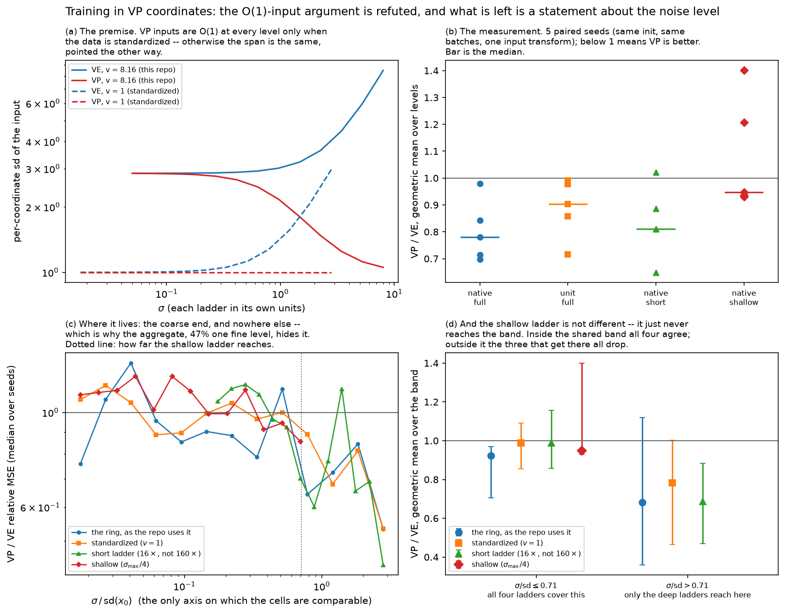

The premise is checkable before anything is trained. For data of per-coordinate
variance $v$, the state at level $\sigma$ has per-coordinate standard deviation
$\sqrt{v+\sigma^2}$ in VE coordinates and $\sqrt{(v+\sigma^2)/(1+\sigma^2)}$
in VP, so:

| | input sd across the ladder | span |
| --- | --- | ---: |
| VE, $v = 8.16$ (this repo's ring) | 2.857 → 8.495 | 2.97x |
| VP, $v = 8.16$ | 2.853 → 1.054 | 2.71x |
| VE, $v = 1$ (standardized) | 1.000 → 2.974 | 2.97x |
| VP, $v = 1$ | 1.000 → 1.000 | **1.00x** |

**VP inputs are $O(1)$ at every level only on standardized data.** Off it the
span is the same size, pointed the other way — which is not what the argument
says, and is why the experiment runs both targets.

The comparison itself is unusually tight, because of the pathwise identity
above: the VP state is the VE state times a per-level scalar and the regression
target $\varepsilon$ is the *same draw* in both, so "train in VP coordinates"
is exactly one multiplication at the network's input
(`diffusion.vp.VPInputScoreNet`). The two arms of a cell therefore share their
seed, their initial weights, their batches and their targets, and differ by
that multiplication alone. Four cells, five paired seeds each, 8,000 steps,
scored as relative score MSE on 13 levels
([`experiments/vp_coords.py`](experiments/vp_coords.py)):

| target, ladder | VE | VP | VP/VE | VP wins |
| --- | ---: | ---: | ---: | ---: |
| ring ($v=8.16$), full | 0.0771 [0.0569–0.0955] | 0.0619 [0.0497–0.0849] | 0.89x | 5/5 |
| standardized, full | 0.0809 [0.0598–0.0943] | 0.0791 [0.0519–0.1073] | 1.05x | 2/5 |
| ring, short ladder (16x) | 0.0157 [0.0129–0.0188] | 0.0155 [0.0114–0.0185] | 1.00x | 3/5 |
| ring, shallow ($\sigma_{\max}/4$) | 0.0748 [0.0392–0.1002] | 0.0812 [0.0595–0.1165] | 1.01x | 2/5 |

That aggregate is 41–47% *one level*: the error at the finest $\sigma$ is 44x
the error at the coarsest, so a mean over the ladder is very nearly the error
at $\sigma_{\min}$, where the two coordinate systems are identical
($\bar\alpha \to 1$). Weighting every level equally instead — the per-seed
geometric mean of the per-level ratio — is what the question actually asks:

| target, ladder | VP/VE over the ladder | VP wins | at the coarsest level | VP wins |
| --- | ---: | ---: | ---: | ---: |
| ring, full | 0.78x | 5/5 | 0.53x | 5/5 |
| standardized, full | 0.90x | 5/5 | 0.54x | 5/5 |
| ring, short ladder | 0.81x | 4/5 | 0.44x | 4/5 |
| ring, shallow | 0.95x | 3/5 | 0.85x | 3/5 |

**So VP helps, and not for the stated reason.** Standardizing the data takes
VP's input span from 2.71x to exactly 1.00x — the $O(1)$ ideal the argument is
about — and it is where VP helps *least* of the three deep cells; at the
coarsest level the two targets are indistinguishable (0.54 against 0.53) across
an 8.2x change in $v$. Cutting the ladder from 160x to 16x with the coarse end
untouched does nothing either. Both hypotheses the design was built around are
refuted by their own controls.

What is left is the noise level. The gain is concentrated above
$\sigma \approx \mathrm{sd}(x_0)$ — below it the four cells run 0.92–0.99x,
which at five paired seeds is at most a few percent and mostly nothing — and
that region is also the tempting place to stop a ladder. The shallow cell, the
only one that stops before it, is the only one without the effect, and it is
not a different regime: it never gets there. Scoring every cell on the band
of $\sigma/\mathrm{sd}$ that all four ladders cover:

| target, ladder | $\sigma/\mathrm{sd} \leq 0.71$ | $> 0.71$ |
| --- | ---: | ---: |
| ring, full | 0.92x [0.70–0.97], 5/5 | 0.68x [0.36–1.12], 4/5 |
| standardized, full | 0.99x [0.86–1.09], 3/5 | 0.78x [0.46–1.00], 4/5 |
| ring, short ladder | 0.99x [0.86–1.16], 4/5 | 0.69x [0.47–0.88], 5/5 |
| ring, shallow | 0.95x [0.93–1.40], 3/5 | ladder does not reach it |

Inside the shared band all four agree and the shallow cell sits in the middle
of them; above it, all three that reach drop to 0.68–0.78. The whole-ladder
numbers differ because they average different bands. And absolute $\sigma$ is
not the variable either: the standardized cell's ladder tops out at 2.80 in
absolute terms against the shallow one's 2.00, and it behaves like the cells
that reach 8.00.

The mechanism this is consistent with is in the closed form and is not
separately tested: at the top of the ladder the VP input is
$\sqrt{\bar\alpha}x_0 + \sqrt{1-\bar\alpha}\,\varepsilon$, so *copying the
input* predicts $\varepsilon$ with relative error
$\bar\alpha v = v/(1+\sigma_{\max}^2) = 0.126$ — the rescaling hands the VP
network most of its own regression target for free, where the VE network has to
divide by $\sigma_{\max}$ first. That identity is measured against a sample
(`test_top_of_ladder_snr_is_the_vp_identity_maps_error`); that it is *why* VP
wins there is not.

Three limits on all of it. Five paired seeds cannot produce a sign-test $p$
below $2/2^5 = 0.0625$, so every "no effect" above means "not resolvable at
five seeds" and the sign test reports that floor next to its $p$. The
comparison is at a fixed 8,000-step budget on one architecture, so this is a
statement about training speed at that budget and not about the converged
model. And whether a 1.5x lower score error at the top of the
ladder changes any *sample* is not measured here. The prediction, from the
sampling section above, is that it does not: at $\sigma_{\max}=8$ even
replacing the prior with an exact draw from $p_{\sigma_{\max}}$ costs nothing
measurable, so the coarse end is not where this repo's sampling error is spent.
That is a prediction and not a result.

## Conditioning: what classifier-free guidance actually samples from

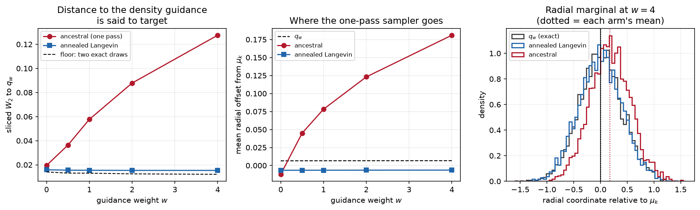

The mixture's component index is a real label, and both conditionals are exact
at every noise level, so classifier-free guidance can be built here with nothing
learned:

$$s_w(x,\sigma) = (1+w)\,\nabla\log p_\sigma(x\mid y{=}k) - w\,\nabla\log p_\sigma(x).$$

That score is the gradient of $r_{w,\sigma} \propto p_\sigma(x\mid
y{=}k)^{1+w}\,p_\sigma(x)^{-w}$ — checked by finite differences, not asserted —
and at $\sigma = 0$ it is $q_w \propto p(x\mid y{=}k)^{1+w} p(x)^{-w}$, the
sharpened conditional guidance is usually said to target. $q_w$ is available by
2-D quadrature, so "does guidance sample from $q_w$?" is a measurement.
Everything below runs both of this repo's samplers on the *same* guided scores,
against exact draws from $q_w$, with the sliced-$W_2$ between two independent
such draws as the floor.

**First, the target does not move — which is a negative about guidance, not
about the samplers.** Sliced $W_2$ between $q_w$ and $q_0$ is 0.0028, 0.0029,
0.0033, 0.0038 at $w = 0.5, 1, 2, 4$, against a floor of 0.012–0.014. On a ring
whose modes sit 7.7 component standard deviations apart, $p(x) \approx
\tfrac18 p(x\mid y{=}k)$ everywhere the conditional has mass, so the ratio being
raised to the power $w$ is a *constant* there and the tilt is a constant.
**$q_w$ is $p(x\mid y{=}k)$ to the resolution available, at every weight tried:
on a well-separated mixture the usual justification for guidance is describing
something that does not happen.** Whatever guidance is doing on real data, it is
not this.

**But the samplers move a long way, and only one of them.** Same scores, same
target that isn't moving:

| $w$ | floor | ancestral $W_2$ | | annealed Langevin $W_2$ | |
|---|---|---|---|---|---|
| 0 | 0.0141 | 0.0194 | 1.4× | 0.0159 | 1.1× |
| 0.5 | 0.0131 | 0.0364 | 2.8× | 0.0156 | 1.2× |
| 1 | 0.0131 | 0.0577 | 4.4× | 0.0154 | 1.2× |
| 2 | 0.0125 | 0.0878 | 7.0× | 0.0154 | 1.2× |
| 4 | 0.0121 | **0.1275** | **10.5×** | 0.0153 | 1.3× |

The one-pass sampler drifts away from $q_w$ monotonically; annealed Langevin
does not, at any weight. And the Langevin arm's residual 1.3× is its budget, not
a bias: doubling the steps per level at $w=4$ takes it from 0.0153 to **0.0116,
below the 0.0121 floor** — indistinguishable from two exact draws.

**Why**, and it is the same sentence this repo has now written three times. The
family $r_{w,\sigma}$ is *not* the noising path of $q_w$: tilting and convolving
do not commute. Annealed Langevin equilibrates at each level, so it is governed
by the last level's stationary law and lands on $q_w$; ancestral sampling makes
one pass and is exact only when its scores are the scores of a genuine noising
path. Approximating the noised marginal by one isotropic Gaussian at the origin
makes the guided drift affine, with root

$$x^\* = \frac{(1+w)\,\mu_k}{(1+w) - w\rho_\sigma},\qquad
\rho_\sigma = \frac{s^2+\sigma^2}{s^2+\sigma^2+R^2/2},$$

whose two limits are the whole mechanism: $\rho \to 1$ at large $\sigma$ gives
$x^\* \to (1+w)\mu_k$, so **the chain is aimed at a point $(1+w)$ times too far
from the origin**, while $\rho \to s^2/(s^2+R^2/2) = 0.02$ at small $\sigma$
brings the attractor back to $\mu_k$. A sampler that equilibrates forgets the
early overshoot; a single pass carries part of it to the end.

**And the drift is not the diversity collapse the folklore predicts.** Two
read-outs that were supposed to show it, and do not:

- *Purity* (fraction of draws nearest component $k$) is **1.0000 at every
  weight, including $w=0$** — saturated by the separation, so it cannot
  distinguish anything here. Reported because it is the number a reader would
  expect to see, and it is uninformative.
- *Width* is non-monotone and small: the ancestral rms distance from $\mu_k$
  goes 0.392, 0.379, 0.378, 0.381, 0.391 over $w=0\ldots4$ against $q_w$'s
  0.399. A 5% dip that comes back is not a collapse.

What actually moves is the **radial position**. The ancestral mean sits at
$-0.012$ from $\mu_k$ at $w=0$ — the same size as $q_w$'s own $+0.007$, i.e.
nothing — and at $+0.181$ by $w=4$: 0.45 of a component standard deviation,
straight outward along the ray the mechanism above predicts. Anchoring at $w=1$
and extending the ancestral arm past the sweep:

| $w$ | 0.5 | 1 | 2 | 4 | 8 | 16 |
|---|---|---|---|---|---|---|
| radial offset | 0.0449 | 0.0782 | 0.1231 | 0.1809 | 0.2520 | 0.3346 |
| $\log(1+w)$ law | 0.0457 | — | 0.1239 | 0.1815 | 0.2478 | 0.3195 |
| ratio | 0.98 | — | 0.99 | 1.00 | 1.02 | 1.05 |

Within 2% out to $w=8$ and 5% at $w=16$, from a single anchor across a 32×
range. **The log law is fitted, not derived**, and the honest version of that
caveat is that integrating the attractor above uniformly over the ladder gives
$\frac{1+w}{w}\log(1+w) - 1$, which has the right leading logarithm and
over-predicts by 22% at $w=16$ — so the ladder's weighting is not uniform, and
what is established is the mechanism and the measurements, not the exponent.

### The other half: what guidance does once the components overlap

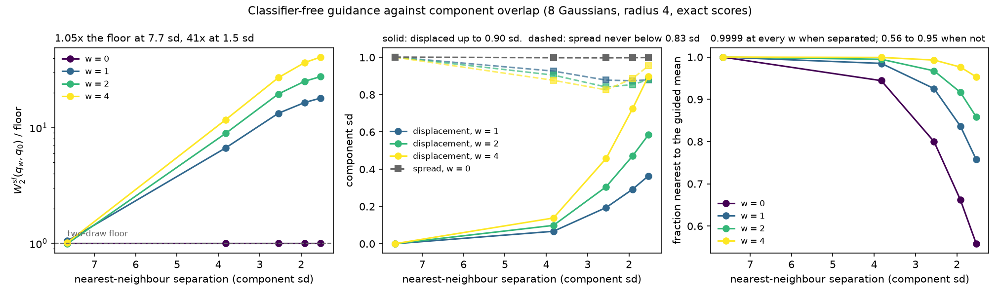

The section above ends on a limitation of its own target rather than of the
method: at 7.7 component standard deviations the tilt is a constant where
$p(x\mid k)$ has mass, so $q_w = p(x\mid k)$ at every weight and the sharpening
guidance is *for* cannot appear. Running the missing half needs only a wider
component. [`experiments/overlap.py`](experiments/overlap.py) holds the ring's
radius and count fixed and widens the Gaussians, taking nearest-neighbour
separation from 7.65 down to 1.53 component sd. Everything stays exact: both
scores, $q_w$ up to the same 2-D quadrature, and draws from it, with the
distance between two independent draws as the floor.

**The controlling variable is one scalar, and it is not a property of the
sampler.** For a mixture, $p(x\mid k)/p(x) = r_k(x)/w_k$ exactly — the
posterior responsibility — so

$$\log q_w(x) - \log q_0(x) = w\big(\log r_k(x) - \log w_k\big) + \text{const},$$

i.e. **the tilt is the responsibility raised to the guidance weight**
([`log_tilt`](diffusion/guidance.py)). Guidance therefore does something
exactly to the extent that $r_k$ *varies* over the conditional's mass; when the
label is already determined by $x$ the tilt is constant and cancels against the
normalizer. That is why the separated ring showed nothing, and $\mathrm{sd}(\log
r_k)$ under $p(\cdot\mid k)$ predicts the whole sweep:

| separation (component sd) | 7.65 | 3.83 | 2.55 | 1.91 | 1.53 |
|---|---|---|---|---|---|
| $\mathrm{sd}(\log r_k)$ under $p(\cdot\mid k)$ | 0.049 | 0.496 | 0.717 | 0.782 | 0.816 |
| $W_2^{\mathrm{sl}}(q_4, q_0)$ / floor | 1.0 | 11.7 | 27.0 | 36.5 | 40.7 |

At 7.65 sd every weight lands within 1.05× the floor: guidance is not weak
there, it is **absent**. One implementation note that is a trap rather than a
detail: `responsibilities().log()` cannot be used to compute this, because on
the default ring the off-component responsibilities are below float32's
smallest normal and the linear form returns exact zeros — on precisely the rows
that establish the separated regime. `log_responsibilities` (a `log_softmax`)
is accurate there and is what `log_tilt` uses.

**And the sharpening, once it is available, is mostly not sharpening.** Split
the effect into the mean's displacement from $\mu_k$ and the spread about it,
both in component sd:

| separation | $w$ | displacement | spread | purity |
|---|---|---|---|---|
| 7.65 | 0 | 0.000 | 1.001 | 0.9999 |
| 7.65 | 1 | 0.000 | 1.002 | 1.0000 |
| 7.65 | 4 | 0.001 | 1.001 | 1.0000 |
| 2.55 | 0 | 0.000 | 0.998 | 0.8001 |
| 2.55 | 1 | 0.194 | 0.878 | 0.9255 |
| 2.55 | 4 | 0.458 | 0.826 | 0.9930 |
| 1.53 | 0 | 0.000 | 0.999 | 0.5583 |
| 1.53 | 1 | 0.364 | 0.880 | 0.7576 |
| 1.53 | 4 | 0.899 | 0.955 | 0.9532 |

The displacement grows without apparent bound and is monotone in $w$ at every
separation, reaching **0.90 component sd**. The narrowing does not: it bottoms
out at **0.83 sd** — a 17% reduction — and then **reverses**, so at 1.91 and
1.53 sd the spread has an interior minimum in $w$ and the strongest guidance
tried is *wider* than half of it. So on this target the honest description of
what the tilt does is that it **moves the conditional away from its
neighbours** far more than it concentrates it, and past a point more guidance
buys only displacement. The displacement follows the same $\log(1+w)$ law the
ancestral drift did, from a $w=1$ anchor — to within 7% in the three most
overlapping cells and 11% at 3.83 sd, where the displacement is 0.14 sd and
there is little to fit. That is a parallel worth naming and not a derivation:
there the sampler drifted on a target that did not move, here the target itself
moves.

The read-out that carries the result is the one the separated study
**discarded**. Purity was a saturated 1.0000 at every weight there and called
useless; here it runs 0.558 → 0.953 over $w = 0 \ldots 4$ at 1.53 sd. A
diagnostic is uninformative relative to a regime, not in itself.

What this does not settle is the sampler question in the overlapping regime.
Everything above is the *target* $q_w$, measured by exact quadrature; whether
ancestral sampling still overshoots it when the components overlap is a
separate run and is not made here.

## Likelihoods, checked against a closed form

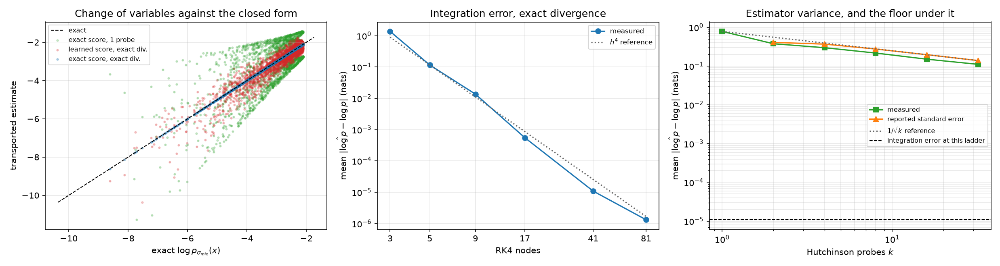

The flow is invertible, so it carries densities as well as points. Along a
trajectory $d/ds \log p_s = -\nabla\cdot v$ (the continuity equation again), and
integrating *up* the ladder gives

$$\log p_{\sigma_{\min}}(x) = \log p_{\sigma_{\max}}(z) + \int_{\sigma_{\min}}^{\sigma_{\max}} \nabla\cdot v \, ds,$$

with the divergence estimated by $\mathbb{E}[\varepsilon^\top J \varepsilon]$ at
one vector-Jacobian product per probe (FFJORD). Probes are drawn **once per
solve**: resampling them inside the integrator makes the augmented field
discontinuous in $s$ and silently costs the solver its order. Rademacher probes
are the default because on a diagonal Jacobian they return the trace exactly,
where Gaussian probes still carry variance — and at points where one mixture
component dominates, the noised score's Jacobian *is* exactly isotropic, so that
is not a hypothetical.

Because the noised mixture's density is closed-form, every number here has a
truth to be wrong against. Two errors, separated:

| RK4 nodes | 3 | 5 | 9 | 17 | 41 | 81 |
| --- | ---: | ---: | ---: | ---: | ---: | ---: |
| mean $\lvert$error$\rvert$, exact divergence (nats) | 1.4e+0 | 1.2e-1 | 1.4e-2 | 5.5e-4 | 1.1e-5 | 1.3e-6 |

| Hutchinson probes $k$ | 1 | 2 | 4 | 8 | 16 | 32 |
| --- | ---: | ---: | ---: | ---: | ---: | ---: |
| mean $\lvert$error$\rvert$ at 41 nodes (nats) | 0.78 | 0.38 | 0.30 | 0.22 | 0.150 | 0.111 |

Integration error falls at roughly $h^4$ until it reaches the float32 noise
floor around $10^{-6}$ (the 81-node point is that floor, not the method's), and
estimator variance falls as $1/\sqrt{k}$ — but at 41 nodes it is still *four
orders of magnitude above* the integration error (0.111 nats at 32 probes
against 1.1e-5). At $d = 2$ the exact trace costs two
backward passes and the estimator costs accuracy, so the honest conclusion is
that Hutchinson is machinery for dimensions this repo does not have, included
because that is where the method is actually used and because its cost is worth
measuring rather than assuming.

### What the model's likelihood is worth, in nats

Each of these three flows is a normalized density, so averaging
$\log p - \log q$ over exact draws estimates $\mathrm{KL}(p_{\sigma_{\min}} \| q)$,
which cannot be negative. 2,000 draws, 41 nodes, exact divergence:

| flow | $\mathbb{E}[\log q]$ | estimated KL (nats) |
| --- | ---: | ---: |
| exact score, exact $p_{\sigma_{\max}}$ prior | −3.1211 | $-9\times10^{-6} \pm 0.0000$ |
| exact score, $N(0,\sigma_{\max}^2)$ prior | −3.1300 | $+0.0089 \pm 0.0029$ |
| **learned** score, $N(0,\sigma_{\max}^2)$ prior | −3.1885 | $+0.0674 \pm 0.0082$ |

The first row is the method's own zero: that flow reproduces the target
exactly, so whatever it reports is the error bar on the other two. Against it,
starting the sampler from a Gaussian instead of $p_{\sigma_{\max}}$ costs
0.0089 nats and the score being learned costs a further 0.0585 — the estimation
error is about seven times the prior gap. Both were visible in the sample
metrics only as "somewhere inside the floor band"; the likelihood puts a number
on each, which is the whole reason to compute one.

## Relation to mcmc-from-scratch

The ULA update

$$x \leftarrow x + \tfrac{\tau}{2}\, s(x) + \sqrt{\tau}\, z$$

is exactly the MALA proposal in
[mcmc-from-scratch](https://github.com/porth-bot/mcmc-from-scratch) with the
Metropolis accept step deleted, and the deletion has a price this repo states
rather than hides: MALA is exact at any step size, ULA is biased by $O(\tau)$.
On a standard Gaussian that bias is closed-form — ULA's stationary variance is
$1/(1-\tau/4)$, 6.7% too wide at $\tau = 0.25$ — and
[`tests/test_langevin.py`](tests/test_langevin.py) measures it. The reason to
accept the bias is not speed: a learned score gives no $\log p$ to put in a
Metropolis ratio, so the accept step is unavailable in principle.

## Reproduce

Every figure, from a clean clone, without training or sampling anything:

```bash
python -m venv .venv && source .venv/bin/activate
pip install torch --index-url https://download.pytorch.org/whl/cpu
pip install -r requirements.txt && pip install -e .
./reproduce.sh                  # 323 tests, then all 13 figures: about a minute
```

Running this repo end to end is about an hour of CPU — the sampler sweep alone
draws 16,000 samples per arm across eight arms and six ladder refinements — so
the artifacts ship with it: CSV sweeps and JSON summaries in `logs/`, the
trained score network in `logs/score_net.pt`, and the sample tensors the cloud
figures are pictures of. The split matters: a figure of a *number* rebuilds
from a sweep log, but a figure of a *cloud* or of a *field* is a picture of
actual draws and of the network itself, and only the tensors and the weights
reproduce those. Each experiment takes `--figures` to replay its own.

`tests/test_reproduction.py` is what keeps that claim true rather than
aspirational: every artifact the replay reads must be **tracked by git**
(sitting in the working tree is not the same thing), and the committed weights
must still load into the `ScoreNet` the code builds today — a break that
retraining would silently paper over, since training rewrites the file it
would have failed on.

`requirements.txt` pins the exact versions the committed artifacts were
produced with (Python 3.12.13, torch 2.13.0); `pyproject.toml` keeps lower
bounds, which is what CI installs on 3.10 and 3.12. The replay is pure
post-processing and is therefore exact — rerunning it leaves the working tree
clean. Recomputation is seeded and replays on the same torch build, but torch
guarantees no bitwise determinism across versions or hardware, which is why
the artifacts are committed rather than regenerated on demand.

To actually recompute:

```bash
python experiments/score_matching.py   # ~2 min   trains the score network
python experiments/sampling.py         # ~20 min  8 sampler arms + ladder sweep
python experiments/ode.py              # ~25 min  NFE sweep + likelihoods
python experiments/schedules.py        # ~15 min  3 ladders x 5 budgets x 3 seeds
python experiments/vp_ve.py            # ~2 min   VP vs VE: 2 targets x 6 sigma_max
python experiments/vp_coords.py --train  # ~35 min VP-coordinate training: 4 cells x 2 x 5 seeds
python experiments/guidance.py         # ~19 min  guidance: 5 weights x 2 samplers + controls
```

## Limitations / next

- **2D toys, and that is the design.** Every number here exists because the
  target's score is closed-form at every noise level. Nothing in this repo
  transfers as a *result* to images or text: no claim is made about sample
  quality on real data, and none of these networks (87k parameters, four
  layers) would be a reasonable model of anything larger. What transfers is
  the machinery and the way of checking it.
- **One trained network.** The score-estimation numbers — the error tables,
  the learned-score rows in every sampler comparison, the 0.0585-nat
  likelihood gap — come from a single training run (seed 0, 60k steps). The
  sampler and schedule comparisons vary the sampler and the ladder against
  that fixed network, which is the right control for *those* questions, but
  none of the learned-score numbers carries a training-seed error bar. The
  exact-score arms have no such caveat. The EMA ablation is the one place with
  five seeds, and what it found there is worth carrying back: at 20k steps the
  seed sd of the score error is 43% of its mean, so a single-seed learned-score
  number in this repo is worth about that much.
- **The shipped network has no EMA, and it should.** `logs/score_net.pt` is
  raw weights from a single 60k-step run, because it was trained before
  `diffusion/ema.py` existed. The ablation says averaging would cut its score
  error several-fold at no training cost — so every learned-score number here
  is a floor on what this architecture and budget can do, not the best of it.
  Retraining and re-deriving the downstream sampler and likelihood numbers is
  a bigger change than adding the ablation was, and it has not been done.
- **`TwoMoons` is a tested density, not an experimental target.** It is a
  genuinely normalized density in polar coordinates with an analytic score,
  and it is checked against the finite-difference oracle — but it is not
  closed under noising, so it cannot supply ground truth at intermediate
  levels, which is what every experiment here needs. The experiments all run
  on the ring mixture for that reason.
- **Guidance's overlapping regime is measured; its sampler in that regime is
  not.** Widening the components until the responsibility varies makes the tilt
  bite ([`experiments/overlap.py`](experiments/overlap.py)), and what it does
  is displace the conditional — up to 0.90 component sd, monotone in $w$ — far
  more than it narrows it (17% at best, then reversing). Every number there is
  the target $q_w$ by exact quadrature, so whether ancestral sampling still
  overshoots once the components overlap is untested.
- **Guidance is measured, and the target it is measured against barely moves.**
  Classifier-free guidance on the component label is now built (exactly, from
  the analytic scores) and scored against the density it is said to target. The
  finding that limits the section is its own: at 7.7 standard deviations of
  separation the tilt is a constant where the conditional has mass, so
  $q_w \approx p(x\mid y{=}k)$ at every weight and this target cannot exhibit
  the sharpening guidance is for. Showing that half needs overlapping
  components, which is the sweep the bullet above reports.
  What this target *can* show, and does, is the sampler-dependence: the
  destination is fixed and the one-pass sampler still drifts 10× the floor.
- **Fast samplers stop at RK4.** The ODE side compares Euler and RK4 at
  matched score evaluations; Heun/EDM-style solvers, DDIM, and distillation
  are not here. On this target the flow is resolved by ~40 evaluations
  anyway, so the study that would justify them is one on a harder target.
- **Hutchinson is measured, not needed.** At $d = 2$ the exact divergence
  costs two backward passes and beats the estimator by four orders of
  magnitude at every probe count tried. It is included because that is what
  the method actually uses in high dimension, and because its cost is worth
  measuring rather than assuming.
- **Float32 throughout.** The likelihood integration error reaches its noise
  floor around $10^{-6}$ nats at 81 RK4 nodes; the 81-node column measures
  the arithmetic, not the method.
- **Variance-exploding only, and now measured to be enough.** The forward
  process here has no drift. Variance-preserving turned out to be a change of
  variables *exactly* -- same chain, pathwise
  ([`diffusion/vp.py`](diffusion/vp.py)) -- and training a network in VP
  coordinates, which is where the O(1)-input argument lives, is worth 0.68-0.78x
  the score error above $\sigma \approx \mathrm{sd}(x_0)$ and little or
  nothing below it, for a reason that is not the O(1)-input argument (that premise holds only
  on standardized data, and standardizing does not help). What is *not* tested
  is whether that coarse-end gain moves a sample, and the sampler's own error
  budget predicts it does not.

## References

Hyvärinen (2005) (score matching); Vincent (2011) (the denoising form, and
the equivalence proof §3.3 rests on); Robbins (1956) / Efron (2011)
(Tweedie's formula, and the curvature bound behind the step-size ceiling);
Song & Ermon (2019, 2020) (annealed Langevin, the $\sigma^2$ weighting,
ladder spacing); Ho, Jain & Abbeel (2020) (the ancestral sampler,
$\epsilon$-prediction); Ho & Salimans (2022) (classifier-free guidance);
Song et al. (2021) (the SDE framing, the probability-flow ODE, likelihoods); Anderson (1982) (the reverse-time SDE);
Nichol & Dhariwal (2021) (the cosine schedule, rederived here for a
variance-exploding process); Karras et al. (2022) ($\sigma$ as the clock);
Chen et al. (2018) and Grathwohl et al. (2019) (instantaneous change of
variables, FFJORD); Hutchinson (1989) (the trace estimator); Roberts &
Tweedie (1996) (ULA's bias, MALA's correction). Full list with roles in
[`theory/derivations.md`](theory/derivations.md).

## Part of a from-scratch series

Same bar in each: the core written out by hand, every non-obvious claim
checked against a closed form or an independent oracle, limitations stated
rather than buried.

| Repo | Built from scratch |
| --- | --- |
| **diffusion-from-scratch** *(this repo)* | Score matching, reverse-time samplers, and the probability-flow ODE — against exact scores at every noise level |
| [mcmc-from-scratch](https://github.com/porth-bot/mcmc-from-scratch) | Metropolis-Hastings, Gibbs, HMC, MALA, NUTS, parallel tempering — validated against exact posteriors |
| [gp-from-scratch](https://github.com/porth-bot/gp-from-scratch) | GP regression, kernels with hand-derived gradients, ML-II, and the NTK/NNGP wide-network correspondence |
| [pinn-from-scratch](https://github.com/porth-bot/pinn-from-scratch) | Physics-informed networks: exact autograd PDE residuals against closed-form solutions |
| [grokking-transformer](https://github.com/porth-bot/grokking-transformer) | A transformer that groks modular arithmetic, and the Fourier circuit it learns |

The load-bearing link is to mcmc-from-scratch, and it is a shared sampler
rather than a shared theme: the Langevin update here *is* that repo's MALA
proposal with the accept step deleted, the deletion is forced (a learned score
gives no density to put in a Metropolis ratio), and both repos measure the
same closed-form ULA bias. The annealing that makes the biased sampler work is
the same idea as its parallel tempering, applied to noise levels instead of
temperatures — and the failure it fixes, a chain trapped in one mode, is
measured on both sides.

## Provenance

A from-scratch study resource for learning how score-based generative models
work. Every derivation is written out — in the module docstrings and, at
length, in [`theory/derivations.md`](theory/derivations.md) — and every
non-obvious claim is tested against a closed-form or independently computed
ground truth rather than taken on faith.

*Suggested GitHub topics:* `diffusion-models` `score-matching`
`generative-models` `sde` `langevin-dynamics` `pytorch` `from-scratch`

## License

MIT — see [LICENSE](LICENSE).
